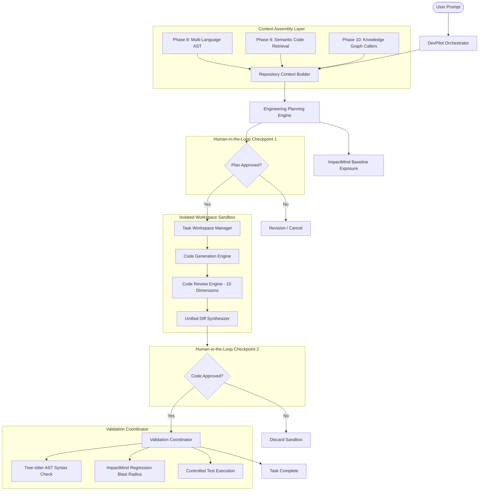

# DevPilot Architecture

DevPilot is Orchestrix AI's autonomous AI software engineering agent. It acts as an autonomous staff engineer capable of planning, implementing, reviewing, and validating repository changes under strict human-in-the-loop governance.

## Core Architectural Components

1. **`DevPilotOrchestrator` (`backend/app/services/devpilot/orchestrator.py`)**
   - Coordinates the finite state machine across the complete task lifecycle:
     `CREATED -> ANALYZING -> PLANNING -> AWAITING_APPROVAL -> GENERATING -> REVIEWING -> AWAITING_MODIFICATION_APPROVAL -> APPLYING -> VALIDATING -> COMPLETED`.
   - Manages transitions, audit trails, and workspace teardown.

2. **`RepositoryContextBuilder` (`backend/app/services/devpilot/context_builder.py`)**
   - Synthesizes repository files, AST symbols, semantic code search results, and knowledge graph call chains into bounded prompt context.
   - Detects ambiguous prompts and triggers `NEEDS_CLARIFICATION`.
   - Rejects destructive prompts requesting unauthorized repository deletion or mass corruption.

3. **`EngineeringPlanningEngine` (`backend/app/services/devpilot/planner.py`)**
   - Generates structured 14-section engineering plans.
   - Computes baseline structural exposure using Phase 11 ImpactMind engine.
   - Decomposes work into granular, risk-scored action items.

4. **`TaskWorkspaceManager` (`backend/app/services/devpilot/workspace_manager.py`)**
   - Isolates code modifications into unique task directories.
   - Validates paths with strict traversal guards against directory escaping (`..`).
   - Computes Git-compatible unified diffs and tracks file additions/deletions.

5. **`CodeGenerationEngine` (`backend/app/services/devpilot/code_generator.py`)**
   - Synthesizes target code modifications and unit tests matching plan steps.
   - Applies language-specific conventions and frameworks.

6. **`CodeReviewEngine` (`backend/app/services/devpilot/code_reviewer.py`)**
   - Analyzes proposed modifications across 10 review dimensions: Correctness, Security, Performance, Error Handling, Architectural Fit, Concurrency, Backward Compatibility, Test Coverage, Code Style, and Dependency Hygiene.
   - Detects out-of-scope modifications (files altered without being in the approved plan).

7. **`ValidationCoordinator` (`backend/app/services/devpilot/validation_coordinator.py`)**
   - Executes multi-stage verification:
     - Stage 1: Tree-sitter AST syntax and parse error validation.
     - Stage 2: ImpactMind post-generation structural exposure scoring.
     - Stage 3: Controlled regression test execution using sandboxed command allowlists and process timeouts.

8. **`LLMProviderManager` (`backend/app/services/devpilot/llm_provider.py`)**
   - Multi-provider fallback chain: Primary (Gemini) -> Fallback (Mistral) -> Deterministic mock provider.
   - Redacts detected tokens, API keys, and connection strings prior to logging or returning results.
