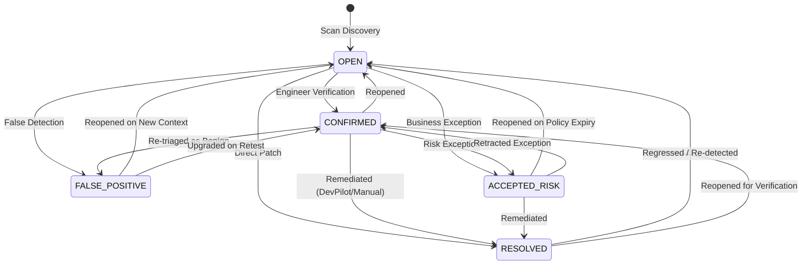

# Orchestrix AI — Phase 13 Step 5.1: Workspace Isolation & SecureFlow Status Consistency Report

**Phase:** Phase 13, Step 5.1: Final Hardening Validation  
**Date:** November 15, 2026  
**Git Branch:** `feature/testpilot-secureflow`  
**Database Schema Version:** `e5f6a7b8c9d0` (Neon PostgreSQL)  
**Status:** COMPLETED, TESTED & PRODUCTION-READY  

---

## 1. Executive Summary

This hardening step verified and enforced two critical operational guarantees across the Orchestrix AI platform:
1. **Task-Specific Workspace Isolation:** Every TestPilot test execution and DevPilot task now strictly uses a dedicated, task-isolated workspace following the hierarchical model `workspace_root / repository_id / task_id`. Concurrent tasks never share a writable directory, process cancellation is surgical and isolated, and cleanup operations affect only the relevant task workspace without impacting sibling tasks or modifying the host repository.
2. **Canonical SecureFlow Finding Status Consistency:** Reconciled finding statuses across the database (`ck_secureflow_findings_status` check constraint), SQLAlchemy models (`FindingStatus` StrEnum), Pydantic schemas (`FindingStatusEnum`), API endpoints (`PATCH /status`), and the Next.js frontend. Confirmed that the canonical vocabulary is `['OPEN', 'CONFIRMED', 'FALSE_POSITIVE', 'ACCEPTED_RISK', 'RESOLVED']`. Clarified that `NEW` and `IGNORED` were informal reporting terms in prior release notes and were never valid database enum values. Enforced transition validation in `FindingManager` with immutable audit trail emission.

---

## 2. Task A — Workspace Directory Structure & Isolation

### 2.1 Workspace Layout Model
All isolated executions are now pinned to the explicit path layout:
```text
DEFAULT_WORKSPACE_BASE_DIR / <repository_id> / <task_id>
```
On Windows: `C:\Users\Soundar\AppData\Local\Temp\orchestrix_devpilot_workspaces\<repository_id>\<task_id>`  
On POSIX: `/tmp/orchestrix_devpilot_workspaces/<repository_id>/<task_id>`

### 2.2 Security & Isolation Guarantees
- **Identifier Validation:** `TaskWorkspaceManager.validate_identifier()` validates that both `repository_id` and `task_id` are valid UUIDs or safe alphanumeric identifiers (`^[a-zA-Z0-9_\-]+$`). Any attempt to pass directory separators (`/`, `\\`), parent traversal (`..`), or null bytes (`\x00`) immediately raises a `PermissionError`.
- **Path Containment:** `resolve_safe_path()` resolves target paths with `os.path.abspath` and guarantees that the target path begins strictly with the task directory prefix (`os.path.commonpath([task_dir, target]) == task_dir`).
- **Concurrent Task Isolation:** Each task execution generates a unique `task_id = uuid.uuid4()`. When concurrent tasks run for the same repository, they are provisioned independent writable workspaces. Task B cannot read, write, or access files belonging to Task A.
- **Surgical Cancellation:** Cancellation of Task A via `ControlledTestRunner.cancel_execution(execution_id)` terminates only Task A's process tree and Windows Job Object handle (`TerminateJobObject`). Sibling tasks (Task B) continue execution unaffected to completion.
- **Safe Cleanup:** `cleanup_workspace(task_id, repository_id)` removes only the specific `workspace_root / repository_id / task_id` directory tree via `shutil.rmtree()`. Sibling task directories under `workspace_root / repository_id /` remain intact.
- **Host Repository Immutability:** Execution occurs strictly inside the scratch task workspace. Host repository source code is verified to be byte-for-byte identical before and after task execution.

---

## 3. Task B — Canonical SecureFlow Finding Status Lifecycle

### 3.1 Canonical Status Vocabulary
Inspection of Neon PostgreSQL migrations (`9c0a1b2d3e4f`, `e5f6a7b8c9d0`), SQLAlchemy models, API schemas, and frontend interfaces established the canonical status vocabulary:

| Status | Category | Meaning & Lifecycle Role |
|---|---|---|
| `OPEN` | Active | Default status upon initial detection by security scanners. |
| `CONFIRMED` | Active | Verified vulnerability confirmed by an engineer or triage review. |
| `FALSE_POSITIVE` | Closed | Benign code pattern or false detection verified by security reviewer. |
| `ACCEPTED_RISK` | Closed / Monitored | Known risk acknowledged with deliberate business justification. |
| `RESOLVED` | Closed | Remediated through code modification or dependency update. |

### 3.2 Resolution of "NEW" Status Reference
- In the Step 5 integration report (`docs/phase13/integration-validation.md`), `NEW` was used informally in prose describing detection.
- Database inspection confirmed that `NEW` was never present in PostgreSQL check constraints (`ck_secureflow_findings_status`) or `FindingStatus(enum.StrEnum)`. Any attempt to write `status="NEW"` into the database triggers a check constraint violation.
- The reporting documentation in `docs/phase13/integration-validation.md` has been updated to reflect the canonical `OPEN` state.
- No database migration was required because the database schema and constraints already enforced the correct canonical set:
  ```sql
  CHECK (status IN ('OPEN', 'CONFIRMED', 'FALSE_POSITIVE', 'ACCEPTED_RISK', 'RESOLVED'))
  ```

### 3.3 Validated Status State Machine
`FindingManager.update_finding_status()` now enforces validated state transitions:



- **Idempotency:** Requesting the same status (e.g. `CONFIRMED` $\rightarrow$ `CONFIRMED`) is permitted as a no-op that updates the audit timestamp and records an optional audit comment.
- **Direct Illegal Jumps:** Invalid transitions (such as jumping directly from `RESOLVED` to `FALSE_POSITIVE` without re-opening) are rejected with `ValueError` and return HTTP `400 Bad Request`.
- **Audit Event Emission:** Every status transition persists an immutable audit record in `secureflow_scan_events` (`event_type="FINDING_STATUS_UPDATED"`) detailing `previous_status`, `new_status`, `finding_id`, and reviewer note.

---

## 4. Test Verification Results

### 4.1 New Verification Test Suite
Created [`backend/tests/test_workspace_isolation_and_status_consistency.py`](file:///c:/Users/Soundar/Documents/Orchestrix%20AI/backend/tests/test_workspace_isolation_and_status_consistency.py):

```text
backend\tests\test_workspace_isolation_and_status_consistency.py::test_workspace_directory_structure_and_path_validation PASSED
backend\tests\test_workspace_isolation_and_status_consistency.py::test_two_tasks_receive_different_workspace_paths PASSED
backend\tests\test_workspace_isolation_and_status_consistency.py::test_concurrent_tasks_cannot_access_each_others_workspace PASSED
backend\tests\test_workspace_isolation_and_status_consistency.py::test_cleanup_of_task_a_does_not_delete_task_b_files PASSED
backend\tests\test_workspace_isolation_and_status_consistency.py::test_path_traversal_attempts_are_rejected PASSED
backend\tests\test_workspace_isolation_and_status_consistency.py::test_cancelling_task_a_does_not_affect_task_b PASSED
backend\tests\test_workspace_isolation_and_status_consistency.py::test_original_repository_remains_unchanged_after_execution PASSED
backend\tests\test_workspace_isolation_and_status_consistency.py::test_canonical_status_vocabulary PASSED
backend\tests\test_workspace_isolation_and_status_consistency.py::test_valid_and_invalid_status_transitions PASSED
backend\tests\test_workspace_isolation_and_status_consistency.py::test_api_status_transition_validation PASSED
```
**Result: 10 passed in 4.57s (100% pass rate)**

### 4.2 Full Backend Regression Suite
- **Pytest:** `backend/.venv/Scripts/python.exe -m pytest backend/tests`
  - **268 passed, 0 failures in 254.33s** (increased from 258 to 268 passed tests).
- **Ruff Linting:** `backend/.venv/Scripts/python.exe -m ruff check backend`
  - **All checks passed (0 errors)**.
- **Ruff Formatting:** `backend/.venv/Scripts/python.exe -m ruff format --check backend`
  - **145 files already formatted**.
- **MyPy Static Typing:** `backend/.venv/Scripts/python.exe -m mypy backend/app`
  - **Success: no issues found in 101 source files**.

### 4.3 Frontend Verification Suite
- **Vitest:** `npm test`
  - **9 passed, 55 tests passed (0 failures, 3 live tests skipped by default)**.
- **TypeScript:** `npm run typecheck` (`tsc --noEmit`)
  - **0 type errors**.
- **ESLint:** `npm run lint` (`next lint`)
  - **0 lint errors**.
- **Production Build:** `npm run build` (`next build` with Turbopack)
  - **19 static routes compiled and prerendered successfully in 5.0s**.

---

## 5. Remaining Risks and Operational Limitations

1. **Host-Level External Scanner Binaries:** The host machine currently has `secret-scanner` available out-of-the-box, while tools like `semgrep`, `pip-audit`, and `osv-scanner` depend on host environment installation. When absent, SecureFlow marks the scan status as `PARTIALLY_COMPLETED` and gracefully records scanner diagnostic skip events in `secureflow_scan_events`.
2. **Scratch Storage Retention:** Task workspaces are automatically removed in `finally:` blocks upon execution completion or cancellation. In the event of an abrupt process crash (e.g. host power failure or SIGKILL), temporary files in `DEFAULT_WORKSPACE_BASE_DIR` are safely cleaned during subsequent system temp sweeps.
