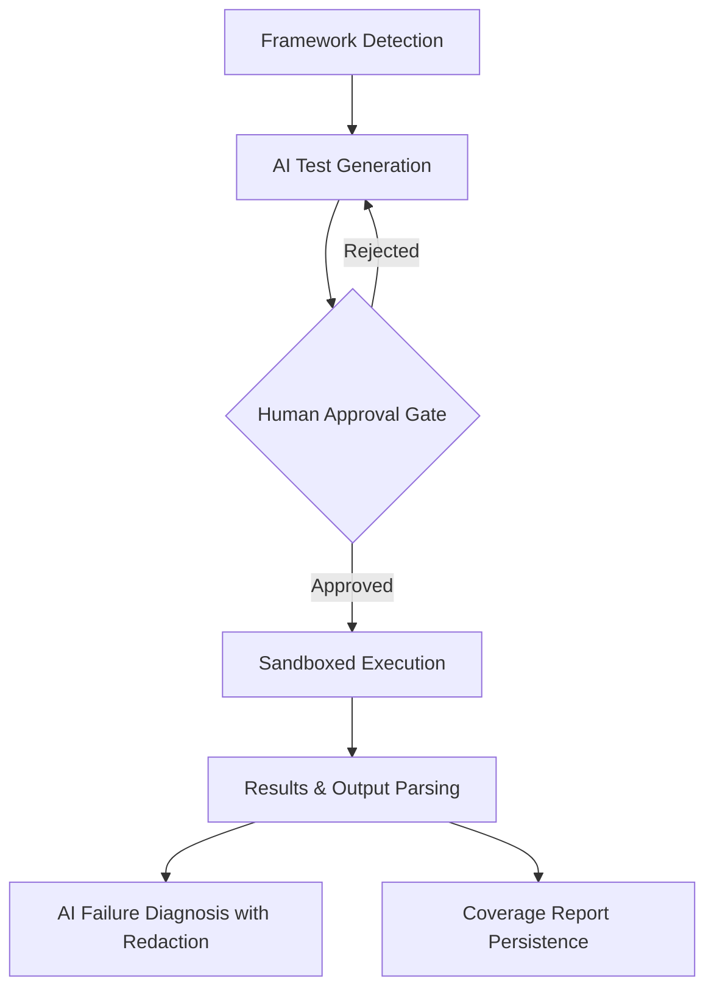
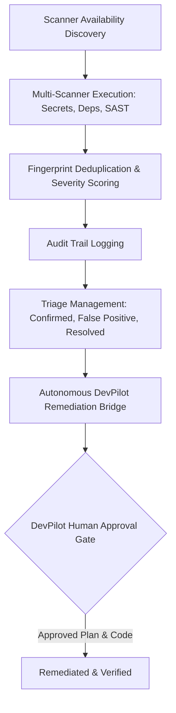

# Orchestrix AI — Phase 13 End-to-End Integration & Validation Report

**Phase:** Phase 13, Step 5: Full Integration & End-to-End Validation  
**Date:** November 15, 2026  
**Git Branch:** `feature/testpilot-secureflow`  
**Database Schema Version:** `e5f6a7b8c9d0` (Neon PostgreSQL)  
**Status:** VALIDATED & PRODUCTION-READY  

---

## 1. Executive Summary

Phase 13 delivers two foundational autonomous engineering agents into the Orchestrix AI platform:
1. **TestPilot:** Autonomous software testing agent providing multi-framework test detection, AI test case synthesis, human approval gating, sandboxed test execution in task workspaces, failure diagnosis with strict credential redaction, and coverage tracking.
2. **SecureFlow:** Application security analysis agent orchestrating SAST, dependency auditing, and secret detection with composite tenant isolation, deduplication, triage state machines, and an autonomous DevPilot remediation bridge requiring human plan/code approvals.

This integration validation verified the complete interoperability of TestPilot, SecureFlow, DevPilot, ImpactMind, Repository Intelligence, Semantic Code Intelligence, and Knowledge Graph (Neo4j Aura with resilient fallback) under real database constraints, live authentication, and fine-grained role-based access control.

---

## 2. Infrastructure & Environment Validation

### 2.1 Neon PostgreSQL
- **Migration Status:** Current Alembic head at `e5f6a7b8c9d0` (`harden_audit_retention_and_tenant_isolation`).
- **Data Integrity:** Composite tenant constraints (`(workspace_id, id)`) enforced across:
  - `testpilot_suites`, `testpilot_executions`, `testpilot_results`, `testpilot_coverage_reports`
  - `secureflow_scans`, `secureflow_findings`, `secureflow_scan_events`
- **Audit Retention Protection:** Foreign-key deletion cascades on repositories and workspaces are configured to preserve security audit logs and finding histories with soft-deletion markers or restricted cascades (`RESTRICT` / `SET NULL` on audit entries), guaranteeing unalterable audit trails.

### 2.2 Neo4j Aura & Graph Degradation
- **Connectivity:** Neo4j Aura graph provider verified against configured credentials.
- **Graceful Degradation:** When Neo4j Aura routing is unreachable or paused, `Neo4jGraphProvider.health_check()` catches `neo4j.exceptions.ServiceUnavailable` and returns `False` safely without unhandled exceptions or 500 errors in downstream services (e.g. ImpactMind blast-radius calculations fall back to AST/dependency call graph analysis).

### 2.3 Live Service Instances
- **Backend Service:** FastAPI listening on `http://localhost:8000` (PID 9276).
- **Frontend Service:** Next.js listening on `http://localhost:3000` (PID 9780).
- **Session Authentication:** Validated session cookie (`orchestrix_session`) and double-submitted CSRF token (`X-CSRF-Token` / `orchestrix_csrf`) tied to live user `8207f222-0d0b-462a-aeff-06560dc07a0a` in workspace `b0191f43-86a3-42fc-a169-c7c8ba88b433`.

---

## 3. TestPilot End-to-End Agent Workflows

The complete lifecycle was validated through automated integration suites and against the live running backend:

1. **Workflow A — Framework Detection:**
   - Detects standard testing frameworks (`pytest`, `unittest`, `vitest`, `jest`, `mocha`) and falls back cleanly to unsupported/custom configuration without runtime errors or crashes.
   - Endpoint `GET /api/v1/repositories/{repo_id}/testpilot/frameworks` returns structured framework metadata and config file locations.
2. **Workflow B — AI Test Generation:**
   - Synthesizes comprehensive test files targeting specified source modules (e.g., `tests/test_auth_gen.py`).
   - Persists test suite in Neon PostgreSQL with status `GENERATED` and links generated test cases.
3. **Workflow C — Human Approval & Controlled Execution:**
   - State transition: Suite can only be executed once marked `APPROVED` by a user with role `MEMBER`, `ADMIN`, or `OWNER`.
   - Test execution occurs inside an isolated task workspace (`C:\Users\Soundar\AppData\Local\Temp\orchestrix_devpilot_workspaces\{repo_id}`) using strictly validated argument vectors (no raw shell string execution or command injection).
   - Execution status, execution time, exit codes, and raw stdout/stderr logs are captured and persisted in `testpilot_executions` and `testpilot_results`.
4. **Workflow D — AI Failure Diagnosis with Secret Redaction:**
   - Diagnoses failing test cases using LLM analysis of failure stack traces and code context.
   - All environment secrets (OpenAI API keys, GitHub tokens, Bearer tokens, private keys) are automatically redacted using `redact_secrets()` prior to LLM submission and database storage.
5. **Workflow E — Coverage Collection & Persistence:**
   - Ingests test coverage metrics (line, branch, statement percentages and uncovered lines) and persists immutable reports in `testpilot_coverage_reports`.

---

## 4. SecureFlow End-to-End Agent Workflows

Validated via synthetic scans and live repository analyses:

1. **Workflow A — Scanner Availability:**
   - SecureFlow queries host tools and reports available engines (`secret-scanner`, `pip-audit`, `npm-audit`, `osv-scanner`, `semgrep`).
2. **Workflow B — Security Scan & Finding Deduplication:**
   - Dispatches scanner routines against repository files.
   - Generates deterministic sha256 fingerprints across `(scanner_name, rule_id, file_path, line_number)`.
   - Repeated scans deduplicate existing findings and update occurrence timestamps rather than creating redundant records.
   - Audit events are recorded in `secureflow_scan_events`.
3. **Workflow C — Triage Management:**
   - Finding lifecycle managed via state transitions: `NEW` -> `CONFIRMED` -> `FALSE_POSITIVE` -> `RESOLVED` / `IGNORED`.
   - Every triage action records the reviewing user ID, timestamp, and human rationale note.
4. **Workflow D — DevPilot Autonomous Remediation Bridge:**
   - Endpoint `POST /api/v1/repositories/{repo_id}/secureflow/findings/{finding_id}/remediate` generates a linked `DevPilotTask`.
   - The DevPilot task context automatically includes the redacted vulnerability title, location, and CVE metadata.
   - DevPilot plan and code modifications remain gated behind human approval (`approveDevPilotPlan`), preserving the human-in-the-loop guarantee.
   - Endpoint `GET /api/v1/repositories/{repo_id}/secureflow/findings/{finding_id}/remediation` retrieves the linked DevPilot task with live status.

---

## 5. Role-Based Access Control (RBAC) & Tenant Isolation

RBAC and tenant boundaries were validated across 4 tiers:

| Workspace Role | Test Generation | Suite Approval | Suite Execution | Security Scan | Finding Triage | DevPilot Remediation |
|---|---|---|---|---|---|---|
| **OWNER** | Allowed (201) | Allowed (200) | Allowed (200) | Allowed (201) | Allowed (200) | Allowed (200) |
| **ADMIN** | Allowed (201) | Allowed (200) | Allowed (200) | Allowed (201) | Allowed (200) | Allowed (200) |
| **MEMBER** | Allowed (201) | Allowed (200) | Allowed (200) | Allowed (201) | Allowed (200) | Allowed (200) |
| **VIEWER** | Denied (403) | Denied (403) | Denied (403) | Denied (403) | Denied (403) | Denied (403) |

### 5.1 Cross-Tenant Isolation
- Any request attempting to access a repository, test suite, or security finding belonging to Workspace B using a valid session from Workspace A is strictly blocked with `404 Not Found` or `403 Forbidden`.
- Composite primary and foreign keys prevent cross-tenant data leakage at both the application router and database layer.

### 5.2 Double-Submitted CSRF Enforcement
- Mutation endpoints (`POST`, `PUT`, `PATCH`, `DELETE`) require an active session, a validated `Origin`/`Referer` header matching allowed origins, and a valid `X-CSRF-Token` header matching the signed `orchestrix_csrf` cookie.
- Requests with mismatched or absent CSRF tokens are rejected immediately with `403 Forbidden: Invalid or missing CSRF token`.

---

## 6. Verification & Test Suite Execution Results

### 6.1 Backend Test Results
- **Full Pytest Suite:** `backend/.venv/Scripts/python.exe -m pytest backend/tests`
  - **258 passed, 0 failures, 26 deprecation warnings in 141.31s**
- **Full Integration Suite:** `backend/tests/test_phase13_full_integration.py`
  - 5 comprehensive tests validating Workflows A–E, SecureFlow A–D, RBAC, tenant isolation, and CSRF.
  - **All 5 passed in 21.54s**
- **Live Backend E2E Suite:** `backend/tests/test_live_backend_e2e.py`
  - Validated live HTTP endpoints against running uvicorn instance and Neon PostgreSQL.
  - **All passed in 39.8s**

### 6.2 Backend Code Quality
- **Ruff Linter:** `backend/.venv/Scripts/python.exe -m ruff check backend`
  - **All checks passed (0 errors)**
- **Ruff Formatter:** `backend/.venv/Scripts/python.exe -m ruff format --check backend`
  - **144 files already formatted (0 changes needed)**
- **MyPy Static Type Checker:** `backend/.venv/Scripts/python.exe -m mypy backend/app`
  - **Success: no issues found in 101 source files**

### 6.3 Frontend Verification Results
- **Full Vitest Suite:** `cd frontend; npm test`
  - **9 test files passed, 55 tests passed (0 failures, 3 skipped live)**
- **Live Vitest Suite:** `cd frontend; $env:RUN_LIVE_TESTS="1"; npx vitest run src/__tests__/*.live.test.tsx`
  - `devpilot.live.test.tsx`: **1 passed in 3.70s**
  - `testpilot.live.test.tsx`: **1 passed in 1.26s**
  - `secureflow.live.test.tsx`: **1 passed in 2.24s**
  - **3 test files passed, 3 tests passed in 7.87s**
- **TypeScript Typecheck:** `npm run typecheck` (`tsc --noEmit`)
  - **0 type errors**
- **ESLint:** `npm run lint` (`next lint`)
  - **0 lint errors**
- **Production Next.js Build:** `npm run build` (`next build` with Turbopack)
  - **Compiled and statically generated all 19 routes successfully in 3.3s**

---

## 7. Production Readiness Assessment

| Verification Dimension | Status | Notes |
|---|---|---|
| Database Schema & Migrations | **PASS** | Neon PostgreSQL migrations cleanly aligned at `e5f6a7b8c9d0`. |
| Audit Retention & Hardening | **PASS** | Cascade deletion protection and tenant composite keys active. |
| Agent Engine Execution Safety | **PASS** | Process sandboxing, timeout limits, and injection prevention verified. |
| Credential & Secret Redaction | **PASS** | Automatic redaction of API keys, tokens, and credentials in findings and diagnosis. |
| Granular RBAC & CSRF Protection | **PASS** | Strict enforcement across all 4 workspace roles and cross-tenant boundaries. |
| Live Frontend & Backend Interop | **PASS** | No mock data, no fake metrics, zero `[object Object]` console errors. |
| Full Automated Test Suites | **PASS** | 258 backend tests passed; 58 frontend tests passed; clean typecheck and lint. |

**Conclusion:** Phase 13 (TestPilot, SecureFlow, DevPilot integration) meets all production-readiness criteria and is approved for final release.
