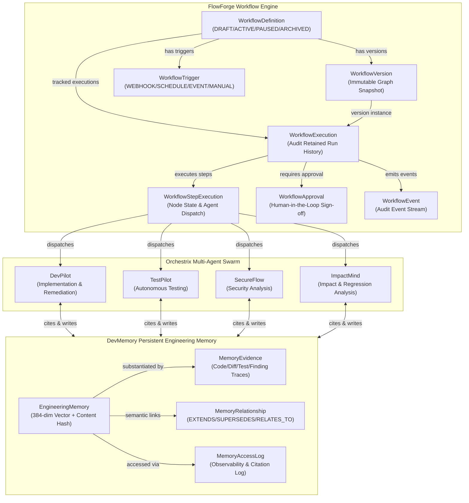
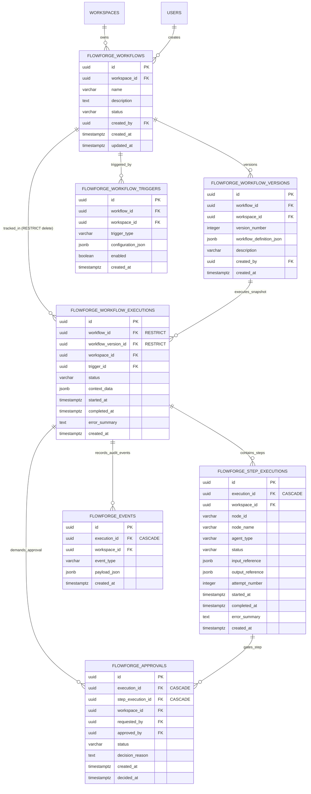
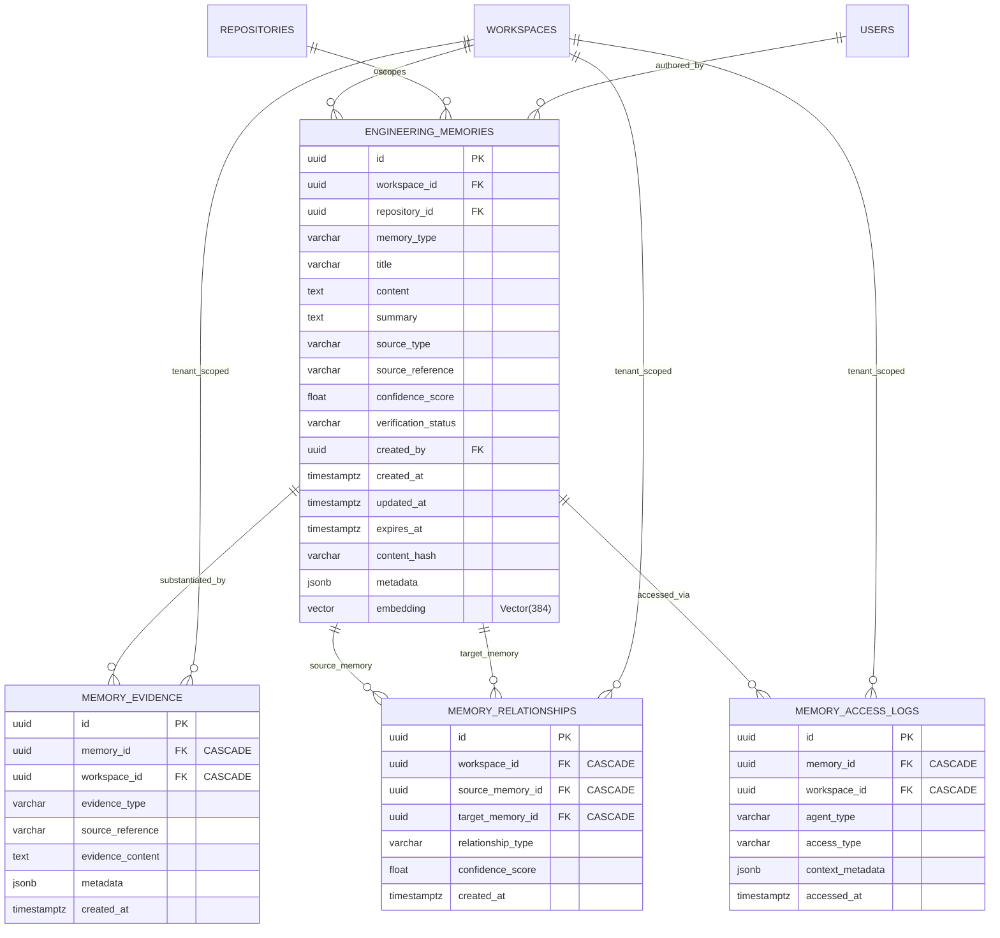

# Orchestrix AI — Phase 14 Step 1: FlowForge & DevMemory Architecture & Database Foundation

## 1. Executive Summary & Design Rationale

Phase 14 Step 1 establishes the production database and architectural foundation for two core subsystems within Orchestrix AI:

1. **FlowForge** — A visual workflow automation engine that enables teams to orchestrate multi-agent engineering workflows (DevPilot, TestPilot, SecureFlow, ImpactMind, Human-in-the-loop approvals, and external webhooks) through declarative, versioned directed acyclic graphs (DAGs).
2. **DevMemory** — A persistent, multi-modal engineering memory system that captures, structures, links, and vectorizes codebase conventions, architectural decisions, verified bug fixes, heuristic patterns, and past task outcomes across workspace tenants.

Both systems are engineered to integrate seamlessly with the existing Orchestrix AI platform, reusing established PostgreSQL extensions (`pgvector`), connection pooling, composite tenant isolation constraints, immutable versioning, and strict audit retention guarantees.

---

## 2. High-Level Architecture

FlowForge coordinates high-level execution pipelines, while DevMemory acts as a persistent institutional knowledge bank accessed across all engineering agents during planning, reasoning, code generation, testing, and security auditing.

---

## 3. FlowForge Entity-Relationship & Schema Specification

### 3.1 FlowForge ER Diagram

### 3.2 FlowForge Schema Tables

#### Table: `flowforge_workflows`
- **Description**: Top-level workflow definition scoped to a tenant workspace.
- **Columns**:
  - `id`: `UUID`, Primary Key, default UUIDv4.
  - `workspace_id`: `UUID`, NOT NULL, FK to `workspaces(id)` ON DELETE CASCADE.
  - `name`: `VARCHAR(255)`, NOT NULL.
  - `description`: `TEXT`, NULL.
  - `status`: `VARCHAR(32)`, NOT NULL, default `'DRAFT'`.
  - `created_by`: `UUID`, NULL, FK to `users(id)` ON DELETE SET NULL.
  - `created_at`: `TIMESTAMPTZ`, NOT NULL, default `NOW()`.
  - `updated_at`: `TIMESTAMPTZ`, NOT NULL, default `NOW()`.
- **Constraints**:
  - Unique: `(workspace_id, name)` -> `uq_flowforge_workflows_workspace_name`
  - Unique: `(id, workspace_id)` -> `uq_flowforge_workflows_id_workspace`
  - Check: `status IN ('DRAFT', 'ACTIVE', 'PAUSED', 'ARCHIVED')` -> `ck_flowforge_workflows_status`
- **Indexes**:
  - `ix_flowforge_workflows_workspace_id` on `(workspace_id)`
  - `ix_flowforge_workflows_status` on `(status)`
  - `ix_flowforge_workflows_created_at` on `(created_at)`

#### Table: `flowforge_workflow_versions`
- **Description**: Immutable graph definition snapshot ensuring past executions reproduce deterministically.
- **Columns**:
  - `id`: `UUID`, Primary Key.
  - `workflow_id`: `UUID`, NOT NULL, FK to `flowforge_workflows(id)` ON DELETE CASCADE.
  - `workspace_id`: `UUID`, NOT NULL, FK to `workspaces(id)` ON DELETE CASCADE.
  - `version_number`: `INTEGER`, NOT NULL.
  - `workflow_definition_json`: `JSONB`, NOT NULL.
  - `description`: `VARCHAR(512)`, NULL.
  - `created_by`: `UUID`, NULL, FK to `users(id)` ON DELETE SET NULL.
  - `created_at`: `TIMESTAMPTZ`, NOT NULL, default `NOW()`.
- **Constraints**:
  - Unique: `(workflow_id, version_number)` -> `uq_flowforge_versions_workflow_version`
  - Unique: `(id, workflow_id)` -> `uq_flowforge_versions_id_workflow`
  - Composite FK: `(workflow_id, workspace_id)` references `flowforge_workflows(id, workspace_id)` ON DELETE CASCADE.
- **Indexes**:
  - `ix_flowforge_versions_workflow_id` on `(workflow_id)`
  - `ix_flowforge_versions_workspace_id` on `(workspace_id)`

#### Table: `flowforge_workflow_triggers`
- **Description**: Automated or manual trigger definitions for workflow execution.
- **Columns**:
  - `id`: `UUID`, Primary Key.
  - `workflow_id`: `UUID`, NOT NULL, FK to `flowforge_workflows(id)` ON DELETE CASCADE.
  - `workspace_id`: `UUID`, NOT NULL, FK to `workspaces(id)` ON DELETE CASCADE.
  - `trigger_type`: `VARCHAR(64)`, NOT NULL.
  - `configuration_json`: `JSONB`, NOT NULL.
  - `enabled`: `BOOLEAN`, NOT NULL, default `TRUE`.
  - `created_at`: `TIMESTAMPTZ`, NOT NULL, default `NOW()`.
- **Constraints**:
  - Composite FK: `(workflow_id, workspace_id)` references `flowforge_workflows(id, workspace_id)` ON DELETE CASCADE.
  - Check: `trigger_type IN ('WEBHOOK', 'SCHEDULE', 'EVENT', 'MANUAL')` -> `ck_flowforge_triggers_type`
- **Indexes**:
  - `ix_flowforge_triggers_workflow_type` on `(workflow_id, trigger_type, enabled)`
  - `ix_flowforge_triggers_workspace_id` on `(workspace_id)`

#### Table: `flowforge_workflow_executions`
- **Description**: Record of an executed instance of a workflow version.
- **Audit Retention**: Uses `ondelete="RESTRICT"` on foreign keys to `flowforge_workflows` and `flowforge_workflow_versions` to prevent accidental deletion of execution audit trails.
- **Columns**:
  - `id`: `UUID`, Primary Key.
  - `workflow_id`: `UUID`, NOT NULL, FK to `flowforge_workflows(id)` ON DELETE RESTRICT.
  - `workflow_version_id`: `UUID`, NOT NULL, FK to `flowforge_workflow_versions(id)` ON DELETE RESTRICT.
  - `workspace_id`: `UUID`, NOT NULL, FK to `workspaces(id)` ON DELETE CASCADE.
  - `trigger_id`: `UUID`, NULL, FK to `flowforge_workflow_triggers(id)` ON DELETE SET NULL.
  - `status`: `VARCHAR(32)`, NOT NULL, default `'PENDING'`.
  - `context_data`: `JSONB`, NULL.
  - `started_at`: `TIMESTAMPTZ`, NULL.
  - `completed_at`: `TIMESTAMPTZ`, NULL.
  - `error_summary`: `TEXT`, NULL.
  - `created_at`: `TIMESTAMPTZ`, NOT NULL, default `NOW()`.
- **Constraints**:
  - Unique: `(id, workspace_id)` -> `uq_flowforge_executions_id_workspace`
  - Composite FK: `(workflow_version_id, workflow_id)` references `flowforge_workflow_versions(id, workflow_id)` ON DELETE RESTRICT.
  - Check: `status IN ('PENDING', 'RUNNING', 'WAITING_FOR_APPROVAL', 'COMPLETED', 'FAILED', 'CANCELLED', 'TIMED_OUT')` -> `ck_flowforge_executions_status`
- **Indexes**:
  - `ix_flowforge_executions_workspace_workflow` on `(workspace_id, workflow_id, status)`
  - `ix_flowforge_executions_status` on `(status)`
  - `ix_flowforge_executions_created_at` on `(created_at)`

#### Table: `flowforge_step_executions`
- **Description**: Execution status and state for individual nodes within a workflow run.
- **Columns**:
  - `id`: `UUID`, Primary Key.
  - `execution_id`: `UUID`, NOT NULL, FK to `flowforge_workflow_executions(id)` ON DELETE CASCADE.
  - `workspace_id`: `UUID`, NOT NULL, FK to `workspaces(id)` ON DELETE CASCADE.
  - `node_id`: `VARCHAR(128)`, NOT NULL.
  - `node_name`: `VARCHAR(255)`, NULL.
  - `agent_type`: `VARCHAR(64)`, NULL (`DEVPILOT`, `TESTPILOT`, `SECUREFLOW`, `IMPACTMIND`, `SYSTEM`, `HUMAN`).
  - `status`: `VARCHAR(32)`, NOT NULL, default `'PENDING'`.
  - `input_reference`: `JSONB`, NULL.
  - `output_reference`: `JSONB`, NULL.
  - `attempt_number`: `INTEGER`, NOT NULL, default 1.
  - `started_at`: `TIMESTAMPTZ`, NULL.
  - `completed_at`: `TIMESTAMPTZ`, NULL.
  - `error_summary`: `TEXT`, NULL.
  - `created_at`: `TIMESTAMPTZ`, NOT NULL, default `NOW()`.
- **Constraints**:
  - Unique: `(id, execution_id)` -> `uq_flowforge_steps_id_execution`
  - Check: `status IN ('PENDING', 'RUNNING', 'WAITING_FOR_APPROVAL', 'COMPLETED', 'FAILED', 'SKIPPED', 'CANCELLED')` -> `ck_flowforge_steps_status`
- **Indexes**:
  - `ix_flowforge_steps_exec_node_attempt` on `(execution_id, node_id, attempt_number)`
  - `ix_flowforge_steps_status` on `(status)`
  - `ix_flowforge_steps_workspace_id` on `(workspace_id)`

#### Table: `flowforge_approvals`
- **Description**: Human-in-the-loop checkpoint requiring explicit human authorization.
- **Columns**:
  - `id`: `UUID`, Primary Key.
  - `execution_id`: `UUID`, NOT NULL, FK to `flowforge_workflow_executions(id)` ON DELETE CASCADE.
  - `step_execution_id`: `UUID`, NOT NULL, FK to `flowforge_step_executions(id)` ON DELETE CASCADE.
  - `workspace_id`: `UUID`, NOT NULL, FK to `workspaces(id)` ON DELETE CASCADE.
  - `requested_by`: `UUID`, NULL, FK to `users(id)` ON DELETE SET NULL.
  - `approved_by`: `UUID`, NULL, FK to `users(id)` ON DELETE SET NULL.
  - `status`: `VARCHAR(32)`, NOT NULL, default `'PENDING'`.
  - `decision_reason`: `TEXT`, NULL.
  - `created_at`: `TIMESTAMPTZ`, NOT NULL, default `NOW()`.
  - `decided_at`: `TIMESTAMPTZ`, NULL.
- **Constraints**:
  - Check: `status IN ('PENDING', 'APPROVED', 'REJECTED', 'EXPIRED', 'CANCELLED')` -> `ck_flowforge_approvals_status`
- **Indexes**:
  - `ix_flowforge_approvals_execution_id` on `(execution_id, status)`
  - `ix_flowforge_approvals_step_id` on `(step_execution_id)`
  - `ix_flowforge_approvals_workspace_id` on `(workspace_id)`

#### Table: `flowforge_events`
- **Description**: Audit event log for workflow execution timeline and observability.
- **Columns**:
  - `id`: `UUID`, Primary Key.
  - `execution_id`: `UUID`, NOT NULL, FK to `flowforge_workflow_executions(id)` ON DELETE CASCADE.
  - `workspace_id`: `UUID`, NOT NULL, FK to `workspaces(id)` ON DELETE CASCADE.
  - `event_type`: `VARCHAR(64)`, NOT NULL.
  - `payload_json`: `JSONB`, NULL.
  - `created_at`: `TIMESTAMPTZ`, NOT NULL, default `NOW()`.
- **Indexes**:
  - `ix_flowforge_events_execution_created` on `(execution_id, created_at)`
  - `ix_flowforge_events_workspace_id` on `(workspace_id)`
  - `ix_flowforge_events_event_type` on `(event_type)`

---

## 4. DevMemory Entity-Relationship & Schema Specification

### 4.1 DevMemory ER Diagram

### 4.2 DevMemory Schema Tables

#### Table: `engineering_memories`
- **Description**: Core engineering memory item storing institutional patterns, conventions, and ADRs with a 384-dimensional vector representation.
- **Columns**:
  - `id`: `UUID`, Primary Key.
  - `workspace_id`: `UUID`, NOT NULL, FK to `workspaces(id)` ON DELETE CASCADE.
  - `repository_id`: `UUID`, NULL, FK to `repositories(id)` ON DELETE CASCADE.
  - `memory_type`: `VARCHAR(64)`, NOT NULL.
  - `title`: `VARCHAR(512)`, NOT NULL.
  - `content`: `TEXT`, NOT NULL.
  - `summary`: `TEXT`, NULL.
  - `source_type`: `VARCHAR(64)`, NOT NULL.
  - `source_reference`: `VARCHAR(1024)`, NULL.
  - `confidence_score`: `FLOAT`, NOT NULL, default `1.0`.
  - `verification_status`: `VARCHAR(32)`, NOT NULL, default `'UNVERIFIED'`.
  - `created_by`: `UUID`, NULL, FK to `users(id)` ON DELETE SET NULL.
  - `created_at`: `TIMESTAMPTZ`, NOT NULL, default `NOW()`.
  - `updated_at`: `TIMESTAMPTZ`, NOT NULL, default `NOW()`.
  - `expires_at`: `TIMESTAMPTZ`, NULL.
  - `content_hash`: `VARCHAR(64)`, NOT NULL (SHA-256 for workspace deduplication).
  - `metadata`: `JSONB`, NULL.
  - `embedding`: `Vector(384)`, NULL (pgvector representation).
- **Constraints**:
  - Unique: `(workspace_id, content_hash)` -> `uq_devmemory_workspace_content_hash`
  - Check: `confidence_score >= 0.0 AND confidence_score <= 1.0` -> `ck_devmemory_confidence_range`
  - Check: `verification_status IN ('UNVERIFIED', 'VERIFIED', 'OUTDATED', 'ARCHIVED')` -> `ck_devmemory_verification_status`
  - Check: `memory_type IN ('ARCHITECTURE_DECISION', 'TECHNICAL_DECISION', 'VERIFIED_BUGFIX', 'REPO_KNOWLEDGE', 'CODE_EXPLANATION', 'ENGINEERING_CONVENTION', 'TASK_OUTCOME', 'IMPLEMENTATION_DISCOVERY', 'KNOWN_LIMITATION', 'VERIFIED_SOLUTION')` -> `ck_devmemory_memory_type`
  - Check: `source_type IN ('AGENT_EXECUTION', 'CODE_REVIEW', 'COMMIT', 'PULL_REQUEST', 'USER_INPUT', 'TEST_FAILURE', 'SECURITY_AUDIT')` -> `ck_devmemory_source_type`
- **Indexes**:
  - `ix_devmemory_workspace_id` on `(workspace_id)`
  - `ix_devmemory_workspace_repo` on `(workspace_id, repository_id)`
  - `ix_devmemory_memory_type` on `(workspace_id, memory_type)`
  - `ix_devmemory_verification` on `(workspace_id, verification_status)`
  - `ix_devmemory_content_hash` on `(content_hash)`
  - `ix_devmemory_created_at` on `(created_at)`

#### Table: `memory_evidence`
- **Description**: Concrete code snippets, log traces, test outputs, or finding references validating the memory.
- **Columns**:
  - `id`: `UUID`, Primary Key.
  - `memory_id`: `UUID`, NOT NULL, FK to `engineering_memories(id)` ON DELETE CASCADE.
  - `workspace_id`: `UUID`, NOT NULL, FK to `workspaces(id)` ON DELETE CASCADE.
  - `evidence_type`: `VARCHAR(64)`, NOT NULL.
  - `source_reference`: `VARCHAR(1024)`, NULL.
  - `evidence_content`: `TEXT`, NOT NULL.
  - `metadata`: `JSONB`, NULL.
  - `created_at`: `TIMESTAMPTZ`, NOT NULL, default `NOW()`.
- **Constraints**:
  - Check: `evidence_type IN ('CODE_SNIPPET', 'LOG_TRACE', 'DIFF_PATCH', 'TEST_OUTPUT', 'SECURITY_FINDING', 'BENCHMARK_RESULT')` -> `ck_devmemory_evidence_type`
- **Indexes**:
  - `ix_memory_evidence_memory_id` on `(memory_id, evidence_type)`
  - `ix_memory_evidence_workspace_id` on `(workspace_id)`

#### Table: `memory_relationships`
- **Description**: Directional graph edges linking memories (e.g. Memory B `SUPERSEDES` Memory A).
- **Columns**:
  - `id`: `UUID`, Primary Key.
  - `workspace_id`: `UUID`, NOT NULL, FK to `workspaces(id)` ON DELETE CASCADE.
  - `source_memory_id`: `UUID`, NOT NULL, FK to `engineering_memories(id)` ON DELETE CASCADE.
  - `target_memory_id`: `UUID`, NOT NULL, FK to `engineering_memories(id)` ON DELETE CASCADE.
  - `relationship_type`: `VARCHAR(64)`, NOT NULL.
  - `confidence_score`: `FLOAT`, NOT NULL, default `1.0`.
  - `created_at`: `TIMESTAMPTZ`, NOT NULL, default `NOW()`.
- **Constraints**:
  - Unique: `(source_memory_id, target_memory_id, relationship_type)` -> `uq_devmemory_rel_source_target_type`
  - Check: `confidence_score >= 0.0 AND confidence_score <= 1.0` -> `ck_devmemory_rel_confidence_range`
  - Check: `relationship_type IN ('EXTENDS', 'SUPERSEDES', 'CONTRADICTS', 'RELATES_TO', 'CAUSED_BY', 'RESOLVED_BY')` -> `ck_devmemory_rel_type`
  - Check: `source_memory_id != target_memory_id` -> `ck_devmemory_rel_no_self_loop`
- **Indexes**:
  - `ix_memory_relationships_source_target` on `(source_memory_id, target_memory_id)`
  - `ix_memory_relationships_workspace_id` on `(workspace_id)`

#### Table: `memory_access_logs`
- **Description**: Append-only log tracking which agent retrieved or cited an engineering memory during planning/execution.
- **Columns**:
  - `id`: `UUID`, Primary Key.
  - `memory_id`: `UUID`, NOT NULL, FK to `engineering_memories(id)` ON DELETE CASCADE.
  - `workspace_id`: `UUID`, NOT NULL, FK to `workspaces(id)` ON DELETE CASCADE.
  - `agent_type`: `VARCHAR(64)`, NOT NULL.
  - `access_type`: `VARCHAR(32)`, NOT NULL.
  - `context_metadata`: `JSONB`, NULL.
  - `accessed_at`: `TIMESTAMPTZ`, NOT NULL, default `NOW()`.
- **Constraints**:
  - Check: `agent_type IN ('DEVPILOT', 'IMPACTMIND', 'TESTPILOT', 'SECUREFLOW', 'FLOWFORGE', 'USER')` -> `ck_devmemory_access_agent_type`
  - Check: `access_type IN ('RETRIEVE', 'CITE', 'APPLY', 'VERIFY', 'INVALIDATE')` -> `ck_devmemory_access_type`
- **Indexes**:
  - `ix_memory_access_logs_memory_workspace` on `(memory_id, workspace_id, accessed_at)`
  - `ix_memory_access_logs_workspace_agent` on `(workspace_id, agent_type)`

---

## 5. Security, Tenant Isolation & Audit Retention

### 5.1 Strict Tenant Isolation
1. **Workspace Boundary**: Every entity across FlowForge and DevMemory contains a mandatory `workspace_id` foreign key referencing `workspaces(id)` with cascade deletion when a workspace is purged.
2. **Composite Foreign Keys**: Version and trigger tables enforce composite foreign keys linking `(workflow_id, workspace_id)` back to `flowforge_workflows(id, workspace_id)`, guaranteeing that child entities cannot be assigned across disparate workspace tenants.
3. **Query Scoping**: All future service queries, vector distance searches, and graph traversals must explicitly filter by `workspace_id`.
4. **Content Hash Isolation**: Deduplication in `engineering_memories` is enforced via `UniqueConstraint("workspace_id", "content_hash")`, isolating identical snippets between different teams.

### 5.2 Audit Retention Strategy
1. **Execution Immutability**: `flowforge_workflow_executions` enforces `ForeignKey("flowforge_workflows.id", ondelete="RESTRICT")` and `ForeignKey("flowforge_workflow_versions.id", ondelete="RESTRICT")`. Deleting a workflow definition is blocked by PostgreSQL if historical executions exist.
2. **Version Freezing**: `flowforge_workflow_versions` entries are append-only. Edits produce new version records rather than mutating existing ones.
3. **Observability Event Logging**: Execution timelines and human approvals are permanently recorded in `flowforge_events` and `flowforge_approvals`.

### 5.3 Vector Embeddings & Deduplication
1. **Dimension Parity**: Standardized at `384` dimensions (`pgvector.sqlalchemy.Vector(384)`), maintaining full compatibility with the existing `FastEmbedProvider` (`BAAI/bge-small-en-v1.5`) and `MockEmbeddingProvider`.
2. **Deduplication**: Content hashing (`SHA-256`) is computed prior to database persistence to detect identical patterns and increment importance/confidence rather than creating duplicate embedding rows.

---

## 6. Alembic Migration Implementation

The database migration was generated under `backend/alembic/versions/f0fef3efd664_create_flowforge_and_devmemory_tables.py`:
- **Branch Point**: Down revision is `e5f6a7b8c9d0` (Phase 13 Step 1.1 hardening).
- **Reversibility**: Both `upgrade()` and `downgrade()` functions are fully implemented with transactional DDL.
- **Vector Support**: `CREATE EXTENSION IF NOT EXISTS vector;` ensures zero manual setup on fresh PostgreSQL/Neon databases.
- **Migration Status**: Verified applied to Neon PostgreSQL (`f0fef3efd664 (head)`).
