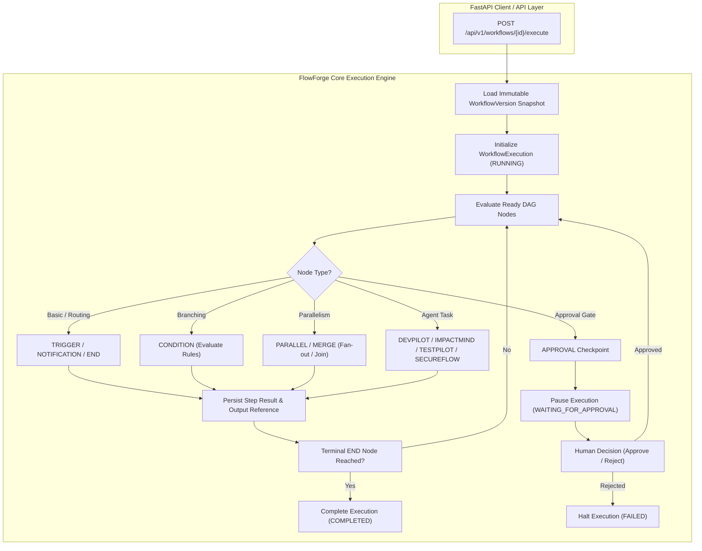

# FlowForge Core Workflow Execution Engine

## 1. Overview

**FlowForge** is the visual workflow orchestration engine for Orchestrix AI. It enables automated, deterministic coordination of multi-agent engineering tasks across:
- **DevPilot** (Autonomous Software Engineering & Remediation)
- **ImpactMind** (Change Impact & Regression Analysis)
- **TestPilot** (Autonomous Software Testing)
- **SecureFlow** (Application Security & SAST Scanning)

Phase 14 Step 2 delivers the **Core Workflow Execution Engine**, graph validation pipeline, human-in-the-loop approval lifecycle, transactional execution persistence, and versioned REST API.

---

## 2. Architecture & Execution Lifecycle

---

## 3. Supported Node Types

FlowForge implements 11 native workflow node types:

| Node Type | Purpose | Required Config | Execution Behavior |
| :--- | :--- | :--- | :--- |
| `TRIGGER` | Workflow entry point | None (or event payload) | Emits initial trigger timestamp. Exactly 1 per workflow. |
| `DEVPILOT` | Autonomous software engineering | `prompt` or `action` | Dispatches task through `DevPilotOrchestrator`, returns task ID reference. |
| `IMPACTMIND` | AST & graph change impact analysis | Optional SHAs | Evaluates change blast radius and regression candidate tests. |
| `TESTPILOT` | Autonomous test execution | Optional framework/action | Runs test framework detection and controlled execution. |
| `SECUREFLOW` | Vulnerability & SAST scanning | `scan_type` (`FULL`, etc.) | Triggers dependency, secret, and SAST scans with redacted outputs. |
| `CONDITION` | Conditional branching | `field`, `operator`, `value` | Evaluates rule without arbitrary code execution; directs flow to `true`/`false` branch. |
| `APPROVAL` | Human-in-the-loop checkpoint | `reason`, optional timeout | Pauses execution in `WAITING_FOR_APPROVAL` until approved or rejected. |
| `PARALLEL` | Concurrent branch fan-out | None | Activates all outgoing downstream branches simultaneously. |
| `MERGE` | Branch join synchronization | None | Waits until all incoming upstream branches have completed. |
| `NOTIFICATION` | Audit & team alerts | `message` | Emits notification record in execution output. |
| `END` | Terminal workflow node | None | Signals completion of an execution branch. |

---

## 4. Graph Validation Engine

The `WorkflowValidator` checks definitions before creation, draft updating, or version publishing:

1. **Structural Integrity**: Nodes and connections must be lists of valid schema objects.
2. **Bounds Protection**: Maximum 250 nodes, 500 connections, and 512KB payload to prevent denial-of-service bombs.
3. **Trigger Invariant**: Exactly one `TRIGGER` node is permitted per workflow.
4. **End Reachability**: At least one `END` node is required, and every reachable node must have a path leading to an `END` node.
5. **Cycle Detection**: Direct acyclic graph (DAG) enforcement using 3-color DFS to detect and reject cycles.
6. **Connection Legitimacy**: All connection source and target IDs must reference existing nodes. Self-loops are rejected.
7. **Node Configuration Rules**: Validates type-specific requirements (e.g., `CONDITION` requires `field` and `operator`; `DEVPILOT` requires `prompt`).
8. **No Code Evaluation**: Does not allow arbitrary Python/JavaScript execution in workflow definitions.

---

## 5. Agent Integration & Security

FlowForge interfaces with existing agents via `FlowForgeAgentAdapter`:
- **Direct Service Reuse**: Reuses `DevPilotOrchestrator`, `ImpactMindEngine`, `TestPilotService`, and `SecureFlowService`.
- **Tenant Context**: Enforces workspace ID and repository ID matching across all agent actions.
- **Output Reference Model**: Stores lightweight references (`task_id`, `scan_id`, execution summary) rather than bloated payloads or raw secret leaks.
- **Graceful Degradation**: Handles missing repositories or unavailable agent services safely without crashing.

---

## 6. Human Approval Engine

Managed via `WorkflowApprovalService`:
- **State Machine**: Transitions through `PENDING -> APPROVED / REJECTED / CANCELLED`.
- **Separation of Duties**: Configurable flag prevents the user who triggered/requested the workflow from approving their own checkpoint.
- **Idempotency**: Duplicate decisions on the same approval checkpoint are rejected.
- **Automatic Resume/Halt**: Approving automatically resumes execution progress; rejecting marks the execution `FAILED` and records the reason in audit logs.

---

## 7. Versioned REST API Endpoints

All endpoints reside under `/api/v1/workflows` and require workspace-scoped authentication and CSRF validation for state-changing operations:

| Method | Endpoint | Min Role | Description |
| :--- | :--- | :--- | :--- |
| `POST` | `/api/v1/workflows` | `MEMBER` | Create a new workflow definition with version 1 |
| `GET` | `/api/v1/workflows` | `VIEWER` | List workflow definitions in workspace |
| `GET` | `/api/v1/workflows/{id}` | `VIEWER` | Get workflow definition and latest version |
| `PATCH`| `/api/v1/workflows/{id}` | `MEMBER` | Update workflow draft metadata or graph |
| `POST` | `/api/v1/workflows/{id}/validate` | `VIEWER` | Validate graph structure without saving |
| `POST` | `/api/v1/workflows/{id}/activate` | `MEMBER` | Activate workflow |
| `POST` | `/api/v1/workflows/{id}/pause` | `MEMBER` | Pause workflow |
| `POST` | `/api/v1/workflows/{id}/versions` | `MEMBER` | Publish an immutable version |
| `GET` | `/api/v1/workflows/{id}/versions` | `VIEWER` | List published versions |
| `POST` | `/api/v1/workflows/{id}/execute` | `MEMBER` | Start execution instance |
| `GET` | `/api/v1/workflows/executions` | `VIEWER` | List workflow executions |
| `GET` | `/api/v1/workflows/executions/{id}` | `VIEWER` | Get execution details and steps |
| `POST` | `/api/v1/workflows/executions/{id}/cancel` | `MEMBER` | Cancel active execution |
| `GET` | `/api/v1/workflows/executions/{id}/events` | `VIEWER` | Get audit events for execution |
| `POST` | `/api/v1/workflows/approvals/{id}/approve` | `MEMBER` | Approve checkpoint and resume |
| `POST` | `/api/v1/workflows/approvals/{id}/reject` | `MEMBER` | Reject checkpoint and halt |

---

## 8. Known Limitations (Phase 14 Step 2 Scope)

1. **No Visual Builder UI**: Visual drag-and-drop graph editor will be implemented in subsequent UI steps.
2. **Cron Scheduler Engine**: Background distributed triggers (cron/scheduled polling) will be delivered in Step 3.
3. **Single Process Worker**: Graph executions currently execute within the FastAPI request lifecycle or in-process async worker rather than Celery/Temporal distributed queues.
