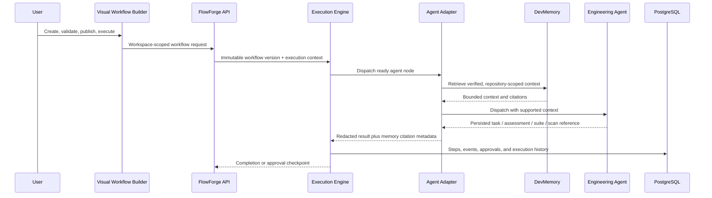

# Phase 14 Step 6 — FlowForge & DevMemory End-to-End Integration

## Integration architecture

## Lifecycle and persistence

FlowForge validates a DAG before draft updates, publishing, activation, and execution. A run always references an immutable `WorkflowVersion`. The execution engine stores every step, attempt, output reference, approval, and event under the workflow workspace. It handles conditional paths, fan-out and merge nodes, cancellation, bounded retries, and recovery of interrupted `RUNNING` executions.

Before every agent-node dispatch, the adapter retrieves a bounded DevMemory context through the existing `DevMemoryContextBuilder`. Retrieval is limited to verified, non-archived, non-outdated memories in the current workspace and configured repository scope (plus workspace-wide memories). The step result stores only citation IDs, counts, status, and repository scope; it never stores memory contents, embeddings, or secrets. A `MEMORY_CONTEXT_RETRIEVED` workflow event records the same reference metadata.

DevPilot receives the verified context appended to its task prompt. TestPilot receives it as source context when generating a suite. ImpactMind and SecureFlow have no prompt-context argument in their existing service APIs; their retrieval is still audited and persisted, but the text is deliberately not fabricated into unsupported service inputs.

## Agent dispatch behavior

| Agent | Dispatch behavior | Persisted reference | Memory handling |
|---|---|---|---|
| DevPilot | Creates/reconciles an idempotent engineering task | `task_id` | Verified context injected into prompt |
| ImpactMind | Calls `analyze_changes` | `assessment_id` | Verified citations retrieved and audited; service has no prompt input |
| TestPilot | Detects a configured directory or generates a suite | detection data / `suite_id` | Verified context supplied to generation source context |
| SecureFlow | Calls `run_scan` for a configured directory | redacted scan summary | Verified citations retrieved and audited; service has no prompt input |
| FlowForge | Executes the immutable graph and records events | execution, step, approval, and event rows | Persists reference-only usage metadata |

TestPilot and SecureFlow require their respective target-directory or generation inputs. When they are absent, FlowForge records an explicit `SKIPPED` step with its reason rather than claiming a completed test or scan.

## Evidence and verification

This integration does not automatically create memories from agent output. The existing DevMemory pipeline is reused: agent-created knowledge remains `UNVERIFIED`, must have evidence before it can be verified, is repository-aware for de-duplication, and remains subject to workspace composite foreign keys and access logging. This avoids treating generated text or retry output as verified engineering fact.

## Approvals, reliability, and isolation

- Approval requests pause execution; only `ADMIN` and `OWNER` can decide them, and requesters cannot approve their own checkpoints.
- Retry attempts are persisted, completed steps are preserved, and DevPilot reconciliation uses a stable dispatch signature rather than a task title.
- Interrupted executions reconcile `RUNNING` steps before resuming; pending approvals remain intact.
- All workflow, execution, step, approval, event, memory, evidence, relationship, and access-log operations are workspace-scoped. Repository memory retrieval is restricted to the requested repository plus explicitly workspace-wide knowledge.

## Validation

The dedicated FlowForge/DevMemory integration coverage is in `backend/tests/test_agent_memory_and_idempotency.py`, including verified repository-scoped memory retrieval, citation persistence on a FlowForge DevPilot step, and isolation from a same-topic memory in another workspace. Existing FlowForge core/security, DevMemory retrieval/API, RBAC, and tenant-integrity suites provide the remaining lifecycle and isolation coverage.

## Operational limitations

- FlowForge execution is in-process; it is not a distributed worker system.
- No automatic memory promotion is performed from agent results; verified knowledge requires the existing evidence-backed lifecycle.
- Browser-level Playwright coverage is not configured in this repository; frontend verification is performed through Vitest and production build checks.
